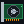

  
   
   

**synthesizing silicon**&nbsp;&nbsp;&nbsp;&nbsp;&nbsp;&nbsp;**taming cuda**&nbsp;&nbsp;&nbsp;&nbsp;&nbsp;&nbsp;**flipping spins**&nbsp;&nbsp;

 
 

  
   
   

  <!-- Project Badges -->
  
  
  
   
  
  

   
   

  <!-- Retro Web Badges -->
  
  
  
  
  

   
   

  <!-- Retro Contact Buttons -->
  
  
  

   
   

  

