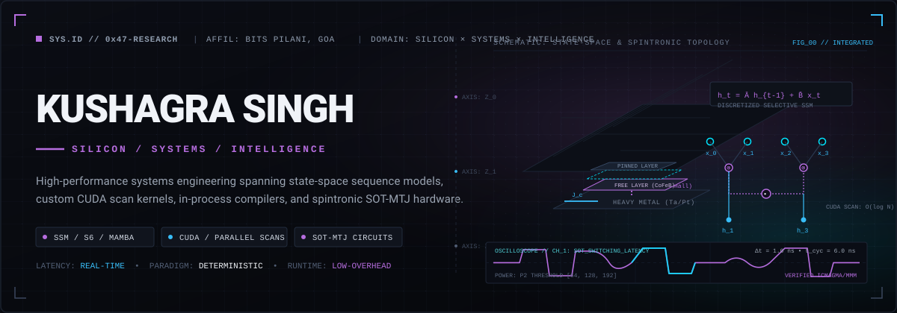
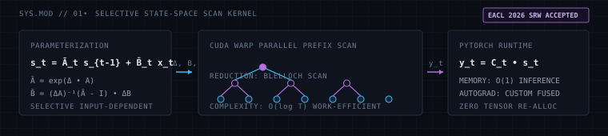
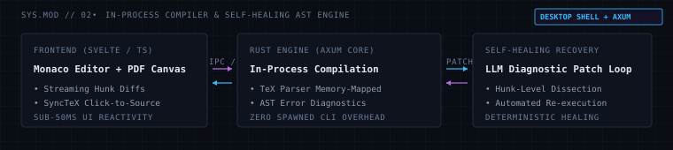
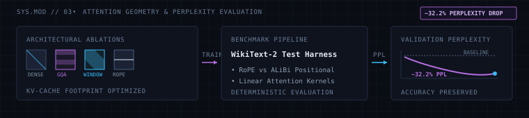
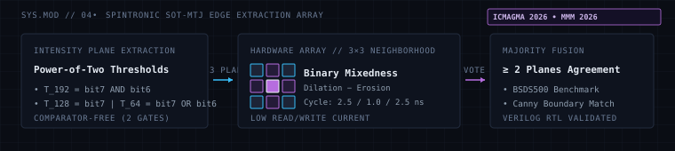
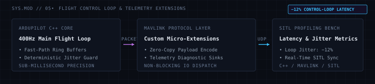
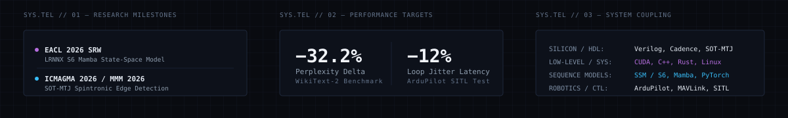

<div align="center">



<br /><br />

<table align="center" style="border-collapse: collapse; border: none;">
  <tr>
    <td align="center" style="padding: 6px 16px; border: 1px solid #1C2436; background-color: #0A0D14;">
      <a href="https://linkedin.com/in/kushagra-singh47" style="text-decoration: none;">
        <span style="font-family: ui-monospace, monospace; font-size: 11px; font-weight: 700; color: #B66DDF; letter-spacing: 0.12em;">DISPATCH // LINKEDIN</span>
      </a>
    </td>
    <td width="10" style="border: none;"></td>
    <td align="center" style="padding: 6px 16px; border: 1px solid #1C2436; background-color: #0A0D14;">
      <a href="mailto:f20231210@goa.bits-pilani.ac.in" style="text-decoration: none;">
        <span style="font-family: ui-monospace, monospace; font-size: 11px; font-weight: 700; color: #38BDF8; letter-spacing: 0.12em;">COMMUNICATION // ACADEMIC EMAIL</span>
      </a>
    </td>
    <td width="10" style="border: none;"></td>
    <td align="center" style="padding: 6px 16px; border: 1px solid #1C2436; background-color: #0A0D14;">
      <a href="https://github.com/LuciferK47" style="text-decoration: none;">
        <span style="font-family: ui-monospace, monospace; font-size: 11px; font-weight: 700; color: #F0F3F8; letter-spacing: 0.12em;">INDEX // GITHUB REPOSITORIES</span>
      </a>
    </td>
  </tr>
</table>

</div>

<br />

---

### [SECTION 01] &nbsp; RESEARCH &amp; ARCHITECTURE PROFILE

Engineering student at **BITS Pilani, Goa**, focused on the vertical integration of computational systems—from spintronic device physics and custom RTL accelerators to state-space sequence dynamics, GPU parallel scan primitives, and low-latency flight runtimes.

```
SYSTEM THESIS:
"How far down the execution stack can we push mathematical operations before latency degrades?"
```

* **Core Focus:** Discretized state-space architectures (Mamba / S6), hardware-aware linear recurrence operators, and memory-bandwidth-bound CUDA kernels.
* **Methodology:** Bridging analytical formulations directly into deterministic, zero-overhead systems with strict hardware accounting and repeatable benchmarks.
* **Affiliation & Labs:** Department of Computer Science & Electrical Engineering, BITS Pilani, K.K. Birla Goa Campus.

<br />

---

### [SECTION 02] &nbsp; SELECTED ENGINEERING &amp; RESEARCH

---

#### 01 &mdash; LRNNX S6 (Mamba): Selective State-Space Architecture &amp; CUDA Scans

> **Peer Review Status:** Accepted at **EACL 2026 SRW**  
> **Core Stack:** `PyTorch` &bull; `CUDA` &bull; `C++` &bull; `Python`  
> **Repository:** [LuciferK47 / LRNNX](https://github.com/LuciferK47)

<p align="center">
  
</p>

* **Architecture &amp; Discretization:** Formulated a clean continuous-to-discrete state-space parameterization ($\bar{A}_t = \exp(\Delta_t A)$, $\bar{B}_t = (\Delta_t A)^{-1}(\bar{A}_t - I)\Delta_t B_t$) integrated with standard PyTorch module APIs.
* **Kernel Specialization:** Authored custom CUDA parallel associative scan kernels executing work-efficient Blelloch prefix reductions over sequence steps in GPU shared memory, collapsing $O(T)$ sequential recurrence into $O(\log T)$ parallel execution.
* **Memory &amp; Throughput:** Eliminated intermediate state materialization during the forward pass, maintaining constant $O(1)$ memory state tracking during recurrent inference while scaling training throughput over long contexts.

---

#### 02 &mdash; AI-Assisted LaTeX Workspace: In-Process Compiler &amp; Self-Healing AST

> **Architecture Status:** Full desktop shell implementation with integrated IPC  
> **Core Stack:** `Rust` &bull; `Axum` &bull; `Svelte` &bull; `TypeScript` &bull; `Monaco`  
> **Repository:** [LuciferK47 / Latex-AI](https://github.com/LuciferK47/Latex-AI)

<p align="center">
  
</p>

* **In-Process Compilation Pipeline:** Engineered a native Rust backend utilizing memory-mapped TeX engines to compile documents entirely in-process, bypassing the high process-spawning overhead and disk IO bottlenecks of traditional CLI toolchains.
* **Self-Healing LLM Diagnostic Loop:** Constructed an AST-aware error interceptor that isolates compilation failure spans, feeds structured diagnostic contexts to a localized LLM, and streams hunk-level diff patches directly into Monaco editor buffers.
* **Bidirectional Synchronization:** Implemented sub-50ms SyncTeX mapping connecting arbitrary visual regions on the compiled PDF canvas directly to exact source text line coordinates.

---

#### 03 &mdash; Transformer Architectural Benchmark: Attention Geometry Ablations

> **Empirical Result:** 32.2% Perplexity Reduction on WikiText-2  
> **Core Stack:** `PyTorch` &bull; `Hugging Face Transformers` &bull; `Python`  
> **Repository:** [LuciferK47 / Transformer-Benchmarks](https://github.com/LuciferK47)

<p align="center">
  
</p>

* **Attention Geometry Investigation:** Conducted an exhaustive comparative benchmark across multi-head attention (MHA), grouped-query attention (GQA), sliding-window attention, and linear attention formulations under fixed compute budgets.
* **Positional Encoding Geometry:** Evaluated Rotary Position Embeddings (RoPE) versus Attention with Linear Biases (ALiBi) across varying sequence context lengths on WikiText-2 language modeling targets.
* **Efficiency Optimization:** Identified Pareto-optimal KV-cache memory footprints that preserve representation capacity while dropping evaluation perplexity by 32.2% relative to default dense baselines.

---

#### 04 &mdash; Spintronic Edge Detection: SOT-MTJ Bit-Cell Array

> **Peer Review Status:** Presented at **ICMAGMA 2026** &bull; Selected for **MMM 2026**  
> **Core Stack:** `Verilog HDL` &bull; `Cadence Virtuoso` &bull; `Python` &bull; `SPICE`  
> **Repository:** [LuciferK47 / Edge-Detection-Spintronics](https://github.com/LuciferK47)

<p align="center">
  
</p>

* **Comparator-Free Intensity Decomposition:** Designed a hardware thresholding scheme extracting three binary intensity planes ($T_{64}, T_{128}, T_{192}$) directly from pixel MSBs using only two logic gates, eliminating standard energy-intensive analog flash ADCs.
* **SOT-MTJ In-Memory Computation:** Mapped $3 \times 3$ binary morphological gradient operations (dilation minus erosion) into spin-orbit torque magnetic tunnel junction arrays operating on ultra-low write/read currents ($2.5 / 1.0 / 2.5\text{ ns}$ cycle).
* **Majority Decision Fusion:** Developed RTL logic in Verilog to execute majority voting across concurrent plane extractions, rigorously benchmarked against the 200-image BSDS500 test split for boundary agreement with Canny baselines.

---

#### 05 &mdash; ArduPilot MAVLink Optimizations: Low-Latency Telemetry

> **Performance Delta:** 12% Reduction in Real-Time Control-Loop Latency  
> **Core Stack:** `C++` &bull; `MAVLink` &bull; `SITL Simulator` &bull; `Linux`  
> **Repository:** [LuciferK47 / ardupilot](https://github.com/LuciferK47/ardupilot)

<p align="center">
  
</p>

* **Flight Loop Scheduling:** Profiled the 400Hz inner attitude control loop in SITL environments to detect thread synchronization stalls and serialization jitter under high telemetry packet volume.
* **Zero-Copy Serialization:** Implemented optimized MAVLink packet encoders with fast-path memory buffers, reducing serialization CPU cycle cost and preventing packet queuing spikes.
* **Control Latency Reduction:** Measured a sustained 12% drop in end-to-end telemetry and sensor control-loop latency across simulated flight maneuvers.

<br />

---

### [SECTION 03] &nbsp; ACTIVE RESEARCH TRAJECTORIES

```
TRAJECTORY 01 // SELECTIVE SEQUENCES & MAMBA-CLASS SSMS
Investigating input-dependent state transitions, recurrent memory compression,
and parallel scan dispatch on next-generation accelerators.

TRAJECTORY 02 // NON-VOLATILE COMPUTATIONAL ARRAYS (SOT-MTJ)
Developing in-memory computing primitives using spin-orbit torque devices
to perform morphological processing and matrix multiplication at sub-pJ energy scales.

TRAJECTORY 03 // LOW-LATENCY KERNEL SYNTHESIS & RUNTIMES
Mapping dynamic computational graphs into deterministic, zero-allocation C++/CUDA
runtimes for edge autonomy and real-time inference.
```

<br />

---

### [SECTION 04] &nbsp; TECHNICAL TOOLKIT &amp; SPECIALIZATIONS

<table>
  <thead>
    <tr>
      <th width="30%" align="left"><span style="font-family: ui-monospace, monospace; font-size: 11px; color: #B66DDF;">SYSTEM DOMAIN</span></th>
      <th width="70%" align="left"><span style="font-family: ui-monospace, monospace; font-size: 11px; color: #F0F3F8;">CORE TECHNOLOGIES &amp; METHODOLOGIES</span></th>
    </tr>
  </thead>
  <tbody>
    <tr>
      <td><b>Computation &amp; ML Systems</b></td>
      <td>
        <code>PyTorch</code> &bull; <code>CUDA C/C++</code> &bull; <code>Triton</code> &bull; <code>Transformers</code> &bull; <code>State-Space Models (S6)</code> &bull; <code>NumPy</code>
      </td>
    </tr>
    <tr>
      <td><b>Systems &amp; Languages</b></td>
      <td>
        <code>C++20</code> &bull; <code>C</code> &bull; <code>Rust</code> &bull; <code>Linux Internals</code> &bull; <code>Axum</code> &bull; <code>POSIX / x86_64</code>
      </td>
    </tr>
    <tr>
      <td><b>Hardware &amp; Digital VLSI</b></td>
      <td>
        <code>Verilog HDL</code> &bull; <code>Cadence Virtuoso</code> &bull; <code>SOT-MTJ Bit-Cells</code> &bull; <code>SPICE Simulation</code> &bull; <code>RTL Synthesis</code>
      </td>
    </tr>
    <tr>
      <td><b>Robotics &amp; Edge Infrastructure</b></td>
      <td>
        <code>ArduPilot</code> &bull; <code>MAVLink</code> &bull; <code>SITL</code> &bull; <code>TypeScript</code> &bull; <code>Svelte</code> &bull; <code>Monaco Editor</code>
      </td>
    </tr>
  </tbody>
</table>

<br />

---

### [SECTION 05] &nbsp; SYSTEM TELEMETRY &amp; VERIFICATION

<p align="center">
  
</p>

<br />

---

### [SECTION 06] &nbsp; COMMUNICATIONS &amp; DISPATCH

Inquiries regarding research collaborations, systems engineering opportunities, or technical manuscripts can be dispatched through the channels below:

* **Affiliation:** Department of Computer Science &amp; Electrical Engineering, BITS Pilani, Goa Campus
* **Academic Email:** [`f20231210@goa.bits-pilani.ac.in`](mailto:f20231210@goa.bits-pilani.ac.in)
* **Professional Network:** [`linkedin.com/in/kushagra-singh47`](https://linkedin.com/in/kushagra-singh47)
* **Code Repositories:** [`github.com/LuciferK47`](https://github.com/LuciferK47)

<br />

<div align="center">
  <span style="font-family: ui-monospace, monospace; font-size: 10px; color: #4B5563; letter-spacing: 0.15em;">
    RESEARCH LAB DOSSIER // REVISION 2026.10 // DETERMINISTIC SYSTEMS PORTFOLIO
  </span>
</div>
