

  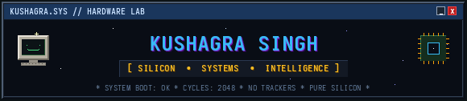
   
   

  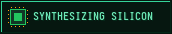
  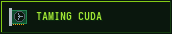
  

 
 

  
   
   

  <!-- Project Badges -->
  <a href="https://github.com/LuciferK47/LRNNX">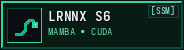</a>
  <a href="https://github.com/LuciferK47/Latex-AI">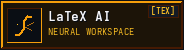</a>
  <a href="https://github.com/LuciferK47/Transformer-Benchmarks">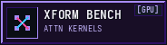</a>
   
  <a href="https://github.com/LuciferK47/Edge-Detection-Spintronics">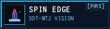</a>
  <a href="https://github.com/LuciferK47/ardupilot">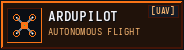</a>

   
   

  <!-- Language Distribution Diagnostics -->
  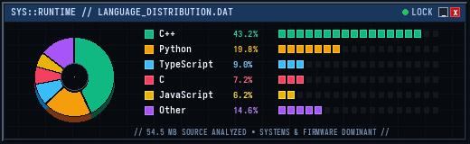

   
   

  <!-- Retro Web Badges -->
  
  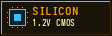
  
  
  

   
   

  <!-- Retro Contact Buttons -->
  
  
  <a href="https://github.com/LuciferK47">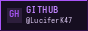</a>

   
   

  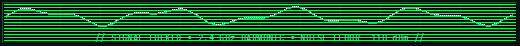

