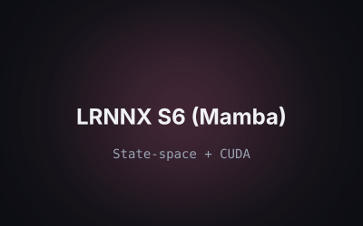
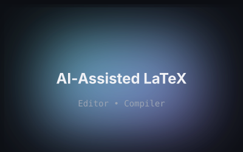
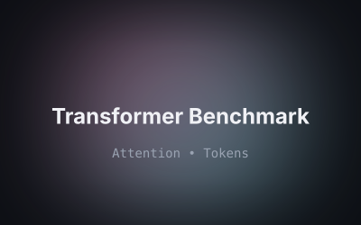
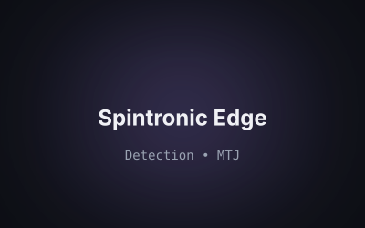
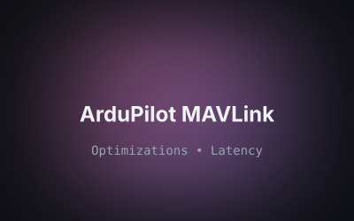

  

<!-- Gallery -->

  <a href="https://linkedin.com/in/kushagra-singh47">LinkedIn</a> •
  <a href="mailto:f20231210@goa.bits-pilani.ac.in">Email</a> •
  <a href="https://github.com/LuciferK47">GitHub</a>

